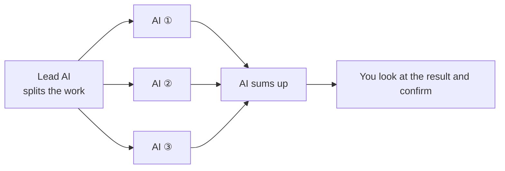

[← README](../README.md) · [中文](features_cn.md)

# What Durweg does

**Turn the way you and your AI always work into a workflow: set it up once, and every new project runs on it; the AI delivers step by step, every step is checked automatically, and it stops only where you chose, so you can look at the results and confirm before it goes on.**

For example, once it is set up, every new project runs like this:

Each step must pass before work moves on: Durweg checks automatically that the result is there and complete, and when you write the workflow you decide which steps wait for your confirmation (it can be just once, at the end). If a check fails or you request changes, the work is revised and reviewed again. Each step can use existing skills and plugins; Durweg manages the order, checks, your approval and records.

## 🧩 Skills, plugins, harnesses and Durweg

**Durweg replaces none of these: a harness runs the model, skills and plugins add to what the agent can do, and Durweg gives a piece of work its steps, checks and record.**

| | What it is | Examples | How it works with Durweg |
| :--- | :--- | :--- | :--- |
| **Harness** | The program that runs a model: it calls the model in a loop, runs its tools, and handles permissions and context | Claude Code, Codex | • Durweg is not a harness: it calls no model and runs inside the one you already use • The agent calls the `durweg` commands, not the other way round |
| **Skill** | Instructions an agent loads when a task needs them | A checklist for reviewing code | • Any step of a workflow can use one • Durweg's own skill, `run-workflow`, teaches the agent to run a workflow |
| **Plugin** | A package that adds skills, commands and similar things to an agent | Durweg's own plugin for Claude Code | • Any step of a workflow can use one • It is one way to [install Durweg](install.md), and a plugin can bring workflows with it |
| **Durweg** | A tool that takes a piece of work through your steps | `durweg start <workflow> <run-name>` | • It keeps the order of the steps, checks each one, waits for your confirmation where you chose and keeps the record |

A skill or plugin can also describe steps and checks, and for many jobs that is enough. Durweg is a ready-made way to do it when you want the same steps, checks and record in every run, across Claude Code, Codex and other agents.

## ✨ Features

| Feature | What you get | More |
| :--- | :--- | :--- |
| **Use the agents you already have open** | • Durweg calls no model API and passes no messages between agents • Each step is done in a Claude Code, Codex or other session you have open; they all read and write the same run record | [Every day](every-day.md) |
| **You decide what it costs** | • The steps are fixed when you write the workflow; no model decides on the fly how many AIs to send out • If you use these agents through a subscription (such as Claude or ChatGPT), there are no extra model API fees (your subscription still has its usage limits) | [Workflow format](workflow-format.md) |
| **Checked automatically, asks you only where you chose** | • Every step is checked automatically for a complete result; if it fails, the work is revised before moving on • You decide which steps wait for your confirmation; it can be just once, at the end | [Workflow format](workflow-format.md) |
| **A record of every step** | • The steps, files, check results and your confirmations of each run are kept in your project's `runs/` • `durweg check` checks the whole record again | [Where your files are](files.md) |
| **Pick up where it stopped** | • Which step a run has reached is saved on disk: if the session closes or the computer crashes, a new agent (it can be a different one) carries on from the step where it stopped • Changes not yet saved at the moment of a crash may be lost | [Where your files are](files.md) |
| **Reuse and share your method** | • Write your way of working down once as a workflow, and every new project runs on it • Keep it in your own library, publish it on GitHub (public or private), or install workflows others made | [Public and private workflows](publish.md#-public-and-private-workflows) |
| **Not tied to one agent** | • Install it as a Claude Code plugin, a Codex plugin, or with the installer • Works on Windows, Mac and Linux | [Install](install.md) |
