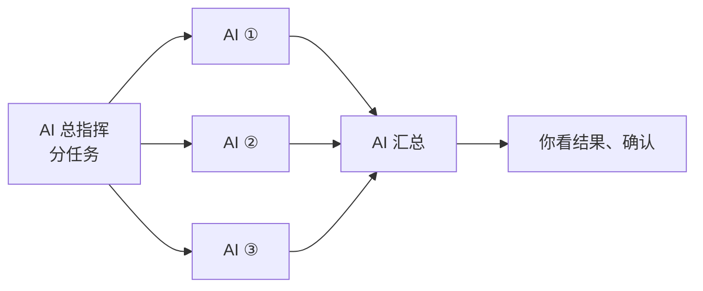

[← README](../README_cn.md) · [English](features.md)

# Durweg 能做什么

**把你和 AI 的一套固定做法定成工作流：定一次，每个新项目都照着跑；AI 按步骤交付，每一步自动检查，只在你选的关键处停下来，等你看结果、确认后再继续。**

例如，定好以后，每个新项目都这样跑：

每一步通过验收才往下走：结果齐不齐全由 Durweg 自动检查；哪几步要你亲自确认，写工作流时由你定，可以只在最后确认一次。检查没过，或你要求修改，就修改后再验收。每一步可以使用已有的 skill 和 plugin；Durweg 管先后顺序、验收、你的确认和记录。

## 🧩 skill、plugin、harness 和 Durweg 的关系

**Durweg 不替代其中任何一个：harness 负责运行模型，skill 和 plugin 增加 agent 能做的事，Durweg 给一件工作定下步骤、检查和记录。**

| | 是什么 | 例子 | 和 Durweg 怎么配合 |
| :--- | :--- | :--- | :--- |
| **Harness** | 运行模型的程序：循环调用模型、执行工具、管理权限和上下文 | Claude Code、Codex | • Durweg 不是 harness：它不调用模型，就在你已经在用的 harness 里运行 • 是 agent 调用 `durweg` 命令，不是反过来 |
| **Skill** | agent 在任务需要时加载的说明 | 一份审查代码的清单 | • 工作流的任何一步都可以使用 • Durweg 自带的 skill `run-workflow` 教 agent 怎么跑工作流 |
| **Plugin** | 给 agent 增加 skill、命令等内容的安装包 | Durweg 自己的 Claude Code 插件 | • 工作流的任何一步都可以使用 • 它是[安装 Durweg](install_cn.md)的一种方式；plugin 也可以自带工作流 |
| **Durweg** | 带着一件工作走完你定的步骤的工具 | `durweg start <workflow> <run-name>` | • 管步骤的先后、检查每一步、在你选的地方等你确认，并保留记录 |

skill 或 plugin 也能写明步骤和检查，很多工作这样就够了。如果你希望每次运行的步骤、检查和记录都一样，并且在 Claude Code、Codex 等不同 agent 上都一样，Durweg 是现成的做法。

## ✨ 特点

| 特点 | 你得到什么 | 详细 |
| :--- | :--- | :--- |
| **用你自己开着的 agent** | • Durweg 不调用模型 API，也不在 agent 之间转发消息 • 每一步由你开着的 Claude Code、Codex 等会话来做，它们读写同一份运行记录 | [每天怎么用](every-day_cn.md) |
| **花多少由你定** | • 步骤是写工作流时定好的，不由模型临时决定要派多少个 AI • 如果你通过订阅使用这些 agent（如 Claude、ChatGPT 订阅），不用另付模型 API 费（订阅本身有用量上限） | [工作流格式](workflow-format_cn.md) |
| **自动把关，关键处才问你** | • 每一步自动检查结果齐不齐全，没过就改，过了才往下走 • 哪几步停下来等你确认，由你定；可以只在最后确认一次 | [工作流格式](workflow-format_cn.md) |
| **每一步都留底** | • 每次运行的步骤、文件、检查结果和你的确认，都存在项目的 `runs/` 里 • `durweg check` 重新核对整个记录 | [文件放在哪里](files_cn.md) |
| **中断了能接着做** | • 做到哪一步存在磁盘上：会话关了或电脑崩溃，新开一个 agent（也可以换一个）就从停下的那一步接着做 • 崩溃那一刻还没保存的改动可能会丢 | [文件放在哪里](files_cn.md) |
| **方法能反复用、能分享** | • 你的做法写成一次工作流，每个新项目都照着跑 • 可以放进自己的库，发布到 GitHub（公开或私有），也可以装别人做好的 | [公开和私密的工作流](publish_cn.md#-公开和私密的工作流) |
| **不绑定某一个 agent** | • 可以装成 Claude Code 插件、Codex 插件，或者用安装器装 • Windows、Mac、Linux 都能用 | [安装](install_cn.md) |
